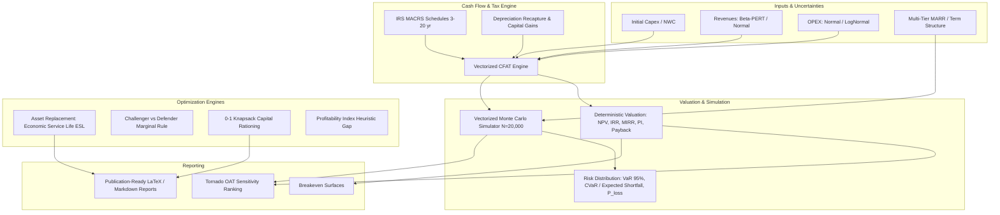

# `stochastic-eng-economics`

[](https://www.python.org/downloads/)
[](https://opensource.org/licenses/MIT)
[](https://docs.pytest.org/)
[](#ai-collaboration-disclosure)

A high-performance, vectorized stochastic engineering economics and capital budgeting engine. Designed for dynamic project valuation under uncertainty, asset replacement optimization, and discrete capital rationing beyond static spreadsheet formulas.

---

## AI Collaboration Disclosure

> **Notice:** This repository was developed with AI assistance using **Gemini Flash**. The core objectives are:
> 1. Testing and evaluating modern AI-assisted engineering and mathematical modeling methodologies.
> 2. Deliberate practice of clean coding standards, rigorous vectorization, and deterministic financial algorithms.
> 3. Revising stochastic engineering economics, corporate tax accounting, and combinatorial optimization from first principles.

---

## Architecture Overview



---

## Mathematical Foundations

### 1. After-Tax Cash Flow with MACRS & Depreciation Recapture
$$
CFAT_t = (R_t - C_t)(1 - \tau) + \tau \cdot D_t
$$
$$
CFAT_0 = -(I_0 + \Delta NWC)
$$
At asset disposal ($t=T$), realized salvage $S_T$ above book value $BV_T$ triggers ordinary income tax on depreciation recapture:
$$
\text{Tax Recapture} = \min(S_T - BV_T, I_0 - BV_T) \cdot \tau
$$

### 2. Beta-PERT Random Variable Formulation
Parameters $(a, m, b)$ define optimistic, mode, and pessimistic engineering estimates:
$$
\mu = \frac{a + 4m + b}{6}, \quad \sigma^2 = \left(\frac{b - a}{6}\right)^2
$$
Sampled via parameterized Beta distribution $\text{Beta}(\alpha_1, \alpha_2)$.

### 3. Coherent Risk Measures: Value-at-Risk & Expected Shortfall
- **Value-at-Risk ($\text{VaR}_\alpha$):**
  $$\text{VaR}_\alpha = -q_{1-\alpha}(NPV)$$
- **Conditional Value-at-Risk ($\text{CVaR}_\alpha$):**
  $$\text{CVaR}_\alpha = \mathbb{E}[-NPV \mid -NPV \ge \text{VaR}_\alpha]$$

### 4. Economic Service Life (ESL) Optimization
Minimizes Equivalent Uniform Annual Cost (EUAC):
$$
\text{EUAC}(k) = \underbrace{(P - S_k)(A/P, i, k) + i \cdot S_k}_{\text{Capital Recovery CR}(k)} + \underbrace{\left[\sum_{t=1}^k \frac{C_t}{(1+i)^t}\right](A/P, i, k)}_{\text{Annual Operating Cost AOC}(k)}
$$

### 5. Discrete Capital Rationing
$$
\max \sum_{j=1}^M x_j \cdot NPV_j \quad \text{s.t.} \quad \sum_{j=1}^M x_j \cdot \text{Capex}_j \le B, \quad x_j \in \{0, 1\}
$$

---

## Benchmark Highlights

Evaluated on a 7-year capital expansion project ($N = 20,000$ Monte Carlo trials):

```text
===========================================================================
STOCHASTIC ENGINEERING ECONOMICS & CAPITAL BUDGETING BENCHMARK
===========================================================================
[1] Deterministic Project Baseline:
  Baseline NPV                 : $67,441.60
  Internal Rate of Return (IRR): 19.19%
  Profitability Index (PI)     : 1.250
  Discounted Payback Period    : 5.53 years

[2] Monte Carlo Risk Valuation (20,000 trials):
  Mean Expected NPV            : $73,668.90
  Standard Deviation           : $28,858.47
  Probability of Loss          : 0.41%
  5th Percentile NPV           : $26,685.17
  95th Percentile NPV          : $121,528.29

[3] Tornado Sensitivity Ranking (Swing Range):
  1. Annual Revenue            : $150,603.97 swing
  2. Capital Expenditure       : $81,547.59 swing
  3. Discount Rate (MARR)      : $50,471.77 swing
  4. Annual OPEX               : $41,073.81 swing
  5. Corporate Tax Rate        : $19,640.86 swing

[4] Asset Replacement Optimization:
  Optimal Service Life (ESL)   : 4 years (Minimum EUAC = $54,809.07/yr)

[5] Capital Rationing (Budget = $140,000):
  Exact 0-1 Knapsack NPV       : $108,000.00
  Greedy PI Heuristic NPV      : $107,000.00
  Knapsack Optimality Surplus  : +$1,000.00
```

---

## Quickstart

```python
from stochastic_econ.cashflow import CashFlowEngine, MACRSDepreciation
from stochastic_econ.simulation import MonteCarloSimulator, BetaPERTParam, NormalParam
from stochastic_econ.optimization import AssetReplacementOptimizer, CapitalRationingOptimizer

# 1. Deterministic Valuation with 5-Year MACRS
engine = CashFlowEngine(
    horizon_years=5,
    initial_capex=100_000,
    revenues=45_000,
    operating_costs=12_000,
    tax_rate=0.25,
    depreciation_schedule=MACRSDepreciation(5),
)
val = engine.evaluate(marr=0.10)
print(f"NPV: ${val.npv:,.2f} | IRR: {val.irr*100:.2f}%")

# 2. Vectorized Monte Carlo Simulation
sim = MonteCarloSimulator(
    horizon_years=5,
    capex_dist=NormalParam(100_000, 8_000),
    revenue_dist=BetaPERTParam(35_000, 45_000, 60_000),
    opex_dist=NormalParam(12_000, 1_500),
    tax_rate=0.25,
)
results = sim.run(n_trials=10_000)
print(results.summary())
```

---

## Directory Structure

```text
stochastic-eng-economics/
├── docs/
│   ├── 01_cash_flow_and_depreciation.md
│   ├── 02_monte_carlo_and_risk.md
│   └── 03_asset_replacement_and_capital_budgeting.md
├── notebooks/
│   ├── 01_capital_budgeting_walkthrough.ipynb
│   └── run_simulation_benchmark.py
├── src/
│   └── stochastic_econ/
│       ├── __init__.py
│       ├── cashflow/
│       │   ├── __init__.py
│       │   ├── cashflow_model.py
│       │   └── depreciation.py
│       ├── optimization/
│       │   ├── __init__.py
│       │   ├── capital_rationing.py
│       │   └── replacement.py
│       ├── reporting/
│       │   ├── __init__.py
│       │   └── sensitivity.py
│       └── simulation/
│           ├── __init__.py
│           ├── distributions.py
│           └── monte_carlo.py
├── tests/
│   ├── conftest.py
│   ├── test_capital_rationing.py
│   ├── test_cashflow.py
│   ├── test_depreciation.py
│   ├── test_monte_carlo.py
│   └── test_replacement.py
├── pyproject.toml
├── .gitignore
├── LICENSE
└── README.md
```

---

## Verification & Testing

```bash
pytest -v
```
All 14 unit tests pass verifying IRS MACRS tables, salvage recapture, multi-tier MARR, IRR root finding, Beta-PERT moments, VaR/CVaR, ESL minimization, and 0-1 Knapsack optimality.
